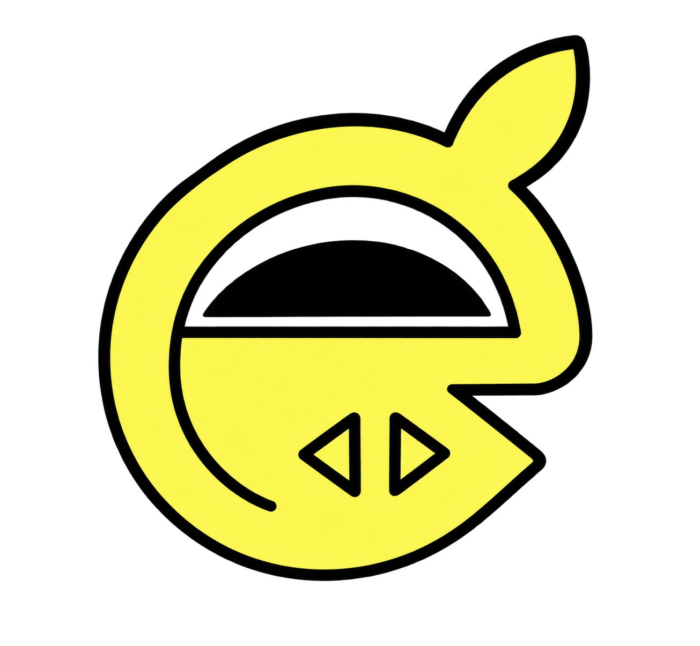

  <picture>
    <source media="(prefers-color-scheme: dark)" srcset="assets/envi-dark.png">
    
  </picture>

<strong>Environment secrets, encrypted, scoped, and audited — as a hosted product, or run entirely on your own infrastructure.</strong>

  
  
  
  
  

---

**Envi** is an environment-secret manager: encrypted `.env` values, scoped access, an audit trail, and a CLI that gets a secret from your database into a running process without anyone typing it into Slack. Envi is built and run as a product — this repository is also the entire self-hostable stack, for teams who'd rather keep everything on infrastructure they control.

Full documentation: **[docs.envisecrets.com](https://docs.envisecrets.com)**
